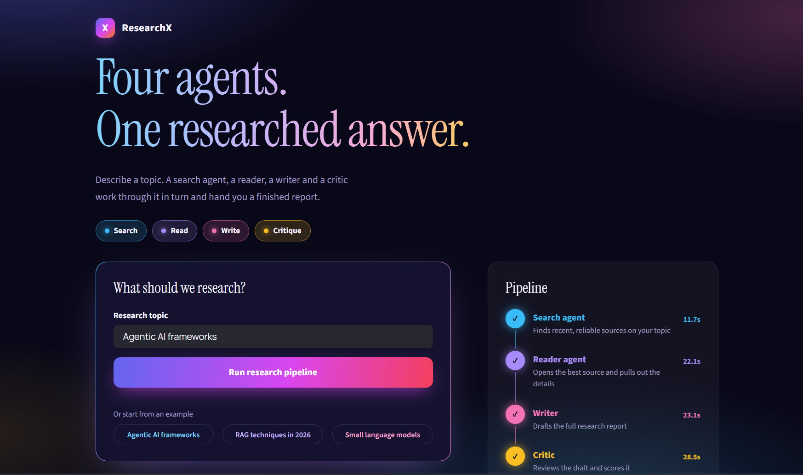
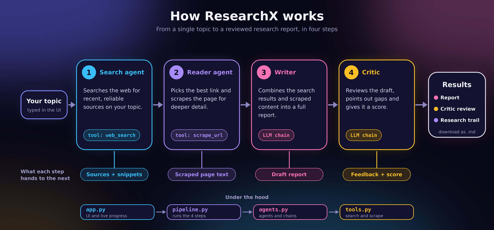

<div align="center">


### 🧠 A multi-agent AI system that searches, reads, writes and critiques, so you get a finished research report on any topic.

<br/>

[](https://multi-agent-systems.onrender.com/)


</div>

---

## 🌐 Live demo

**👉 [multi-agent-systems.onrender.com](https://multi-agent-systems.onrender.com/)**

> 💤 If the app has been idle, free hosting tiers can take a short while to wake up on the first visit. Give it a moment and refresh.

<div align="center">



</div>

---

## ✨ How it works

Four specialised agents, each with its own colour, work through your topic one after another. Every step's output feeds the next.

| | Step | Agent | What it does |
|:-:|:-:|---|---|
| 🔵 | **1** | **Search agent** | Finds recent, reliable sources on your topic |
| 🟣 | **2** | **Reader agent** | Opens the most relevant source and extracts the details |
| 🌸 | **3** | **Writer** | Drafts the full research report from the search and scraped content |
| 🟡 | **4** | **Critic** | Reviews the draft and scores it |

<div align="center">



</div>

---

## 🎨 Features

- ⚡ **Live pipeline view** that updates as each agent finishes, with the time each step took
- 📑 **Tabbed results**: Report, Critic review and the raw Research trail
- ⬇️ **One-click download** of the report as Markdown
- 💡 **Clickable example topics** to get started fast
- 🛟 **Clear error handling**: if a step fails you see why, and partial results are kept
- 🌈 **Colourful custom UI** with a gradient headline, per-agent colours and a page icon drawn in code (no image files needed)

---

## 🗂️ Project structure

```
.
├── app.py              # Streamlit UI (layout, styling, live progress)
├── pipeline.py         # Runs search -> read -> write -> critique (no Streamlit code)
├── agents.py           # build_search_agent, build_reader_agent, writer_chain, critic_chain
├── tools.py            # web_search and scrape_url tools used by the agents
├── assets/
│   ├── screenshot.png  # README screenshot
│   └── workflow.png    # README workflow diagram
├── .env                # API keys (not committed)
└── README.md
```

How the files connect:

```
app.py  ->  pipeline.py  ->  agents.py  ->  tools.py
```

- `app.py` calls `iter_pipeline(topic)` from `pipeline.py` and redraws the page as each step finishes.
- `pipeline.py` imports `build_search_agent`, `build_reader_agent`, `writer_chain` and `critic_chain` from `agents.py`.
- `agents.py` should use the tools in `tools.py`, for example `from tools import SEARCH_TOOLS, READER_TOOLS`.

You can also run the pipeline without the web app:

```bash
python pipeline.py "Agentic AI frameworks"
```

---

## 🚀 Getting started

### 1️⃣ Clone the repo

```bash
git clone <your-repo-url>
cd <your-project-folder>
```

### 2️⃣ Create a virtual environment

```bash
python -m venv .venv

# macOS / Linux
source .venv/bin/activate

# Windows
.venv\Scripts\activate
```

### 3️⃣ Install dependencies

```bash
pip install "streamlit>=1.39" numpy pillow langchain langchain-core beautifulsoup4 requests tavily-python python-dotenv
```

Also install whatever else `agents.py` imports (your LLM provider package, search tool, scraping libraries and so on).

> ⚠️ **Streamlit 1.39 or newer is required.** The UI styling uses keyed containers, which older versions don't support.

### 4️⃣ Add your API keys

Create a `.env` file in the project root with the keys your `agents.py` needs, for example:

```
TAVILY_API_KEY=...        # used by web_search in tools.py
YOUR_LLM_API_KEY=...      # replace with the variable your LLM provider expects
```

🔒 Never commit this file. Add `.env` to your `.gitignore`.

### 5️⃣ Run it

```bash
streamlit run app.py
```

Open <http://localhost:8501> and you're in.

---

## 🧭 Usage

1. ✍️ Type a topic, or click an example chip.
2. ▶️ Press **Run research pipeline**.
3. 👀 Watch the four steps light up in the Pipeline panel.
4. 📖 Read the **Report**, check the **Critic review**, or inspect the **Research trail**.
5. 💾 Grab the result with **Download report (.md)**.

---

## ☁️ Deploying on Render

Typical settings for a Streamlit web service on [Render](https://render.com):

| Setting | Value |
|---|---|
| **Build command** | `pip install -r requirements.txt` |
| **Start command** | `streamlit run app.py --server.port $PORT --server.address 0.0.0.0` |
| **Environment variables** | Add your API keys in the Render dashboard (don't commit `.env`) |

---

## 🎛️ Customisation

- 💡 **Example topics:** edit the `EXAMPLES` list near the top of `app.py`. Keep each one short so the chips don't wrap.
- 🔎 **Search provider:** `tools.py` uses Tavily. To switch providers, change only the body of `web_search`; the rest of the app stays the same.
- 🎨 **Agent colours:** set in the `STEPS` list in `app.py`. The matching CSS variables live in the `:root` block of the stylesheet.
- 🖼️ **Page icon:** drawn by `make_icon()` in `app.py`. Change the gradient stops or strokes there.
- 🔗 **Context passed to the Reader:** the Reader receives the first 800 characters of the search output. Change `READER_CONTEXT_CHARS` in `pipeline.py` if useful URLs are being cut off.

---

## 🩺 Troubleshooting

<details>
<summary><b>🔌 "The pipeline stopped: ... RemoteDisconnected ..."</b></summary>

<br/>

The server dropped the connection while an agent was calling an external service. Common causes are a missing or invalid API key, rate limiting on a free tier, or a VPN or firewall blocking Python's outgoing requests. Test the failing agent on its own to see the full traceback:

```python
from agents import build_search_agent

agent = build_search_agent()
out = agent.invoke({"messages": [("user", "latest developments in agentic AI")]})
print(out["messages"][-1].content)
```

Adding retries and a timeout when you create the model in `agents.py` (for example `max_retries=3, timeout=60`) also helps with flaky connections.

</details>

<details>
<summary><b>🧩 Buttons, cards or tabs look unstyled</b></summary>

<br/>

Check your version with `pip show streamlit` and upgrade with `pip install -U streamlit` if it is older than 1.39.

</details>

<details>
<summary><b>🔤 Fonts don't load</b></summary>

<br/>

The UI loads Instrument Serif and Manrope from Google Fonts, so it needs an internet connection. Without it, the app falls back to Georgia and system fonts.

</details>

---

## 🛠️ Tech stack

<div align="center">


<br/>


</div>
